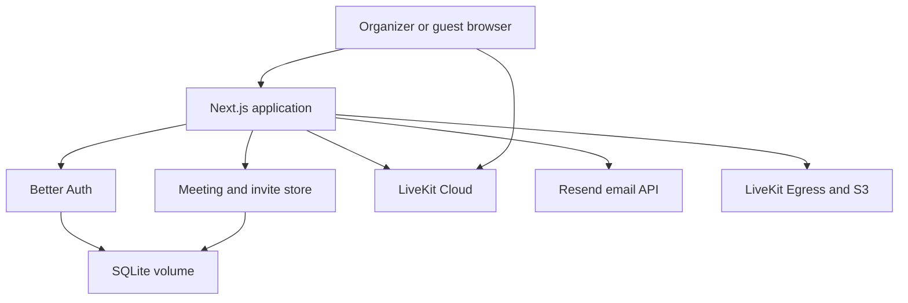

# Alessio Bellan Meet threat model

## Executive summary

This repository is a Next.js video meeting service with Better Auth, SQLite, and LiveKit Cloud. The highest-risk asset is access to a private meeting through a bearer invite link. The new server-side flow stores only a SHA-256 invite hash, validates revocation before minting a five-minute LiveKit token, and creates LiveKit rooms with a five-person limit. Residual priorities are invite-link leakage or replay, abuse of the public token endpoint, and hardening the legacy recording API from GET to POST with explicit CSRF protection.

## Scope and assumptions

- In scope: `app/**`, `lib/**`, `auth.ts`, `next.config.js`, Docker files, `.env.example`, and the SQLite data path.
- Runtime: one Next.js container on an internet-facing VPS, with LiveKit Cloud as the media service and Resend as the optional email provider.
- Intended users: one configured organizer and up to five participants per meeting. Guests use a bearer invitation without an account.
- Assumed data sensitivity: business conversation audio/video, participant names, meeting titles, session cookies, LiveKit credentials, and passkey records.
- Out of scope: LiveKit Cloud internals, the VPS host and reverse proxy hardening, Resend account security, browser/WebRTC implementation bugs, and physical device compromise.
- No production deployment or tenant model was supplied. Priorities assume a single-owner service exposed to the public internet.

Open questions that would change the ranking: should invitation links expire automatically; must a link be single-use or reusable until revoked; is recording required in production; and which reverse proxy terminates HTTPS?

## System model

### Primary components

- Next.js App Router serves the Italian UI, Better Auth handler, organizer API routes, invite lookup, and LiveKit token endpoint.
- Better Auth uses SQLite tables for the organizer user, session, verification, passkey, and rate-limit records.
- The application SQLite file stores meeting metadata, hashed invite tokens, status, and audit events.
- LiveKit Cloud receives server-created rooms and short-lived participant JWTs. Media flows directly between browser clients and LiveKit.
- Resend is an optional external email API used only by the Better Auth magic-link callback.

### Data flows and trust boundaries

- Internet browser -> Next.js pages: HTML, names, titles, email, passkey ceremonies, and invite tokens over HTTPS. Next.js validates title/name length; Better Auth validates origins and CSRF-sensitive auth requests.
- Organizer browser -> Better Auth API: email/passkey credentials and session cookies. Better Auth owns session issuance, rate limiting, CSRF checks, and trusted origins; organizer APIs repeat the organizer-email authorization check.
- Organizer browser -> meeting API -> SQLite: title, meeting ID, status, and audit data. API requires an authenticated organizer and same-origin mutation requests.
- Guest browser -> invite lookup/token API -> SQLite: bearer invite token and participant name. The token is hashed before lookup; revoked or unknown tokens are rejected; participant names are length/control-character validated.
- Next.js -> LiveKit Cloud: server-held API key/secret, room name, max participant configuration, and short-lived guest JWT. Credentials never go to the browser; JWT grants are scoped to one room.
- Next.js -> Resend: organizer email and magic-link URL. The flow fails when `RESEND_API_KEY` is absent and does not simulate delivery.
- Organizer browser -> recording API -> LiveKit Egress/S3: room name and authenticated session. The endpoint checks organizer access and meeting existence; recording storage still depends on external S3 configuration.
- Container -> SQLite volume: auth state, meeting state, hashes, and audit events. Docker runs as non-root and persists `/app/data`.

#### Diagram

## Assets and security objectives

| Asset | Why it matters | Security objective (C/I/A) |
|---|---|---|
| `LIVEKIT_API_SECRET` and Better Auth secret | Server signing and session integrity | C/I |
| Better Auth sessions and passkeys | Organizer control over all meetings | C/I/A |
| Invite token and meeting status | Bearer access to private rooms | C/I |
| LiveKit participant JWTs | Audio/video access and publish rights | C/I |
| Meeting titles and participant names | Business metadata and PII | C/I |
| SQLite auth and meeting database | Persistent access, revocation, and history | C/I/A |
| Audit log | Investigation and accountability | I/A |
| LiveKit/S3 quota and recording storage | Cost, availability, and sensitive recordings | C/I/A |
| Docker image and dependency lockfile | Supply-chain integrity | I/A |

## Attacker model

### Capabilities

- Remote unauthenticated attacker can request public pages, probe invite and token endpoints, submit names, and attempt rate-limit or resource-exhaustion attacks.
- Attacker who obtains an invite URL can present it as a bearer credential and attempt to join until revocation or token expiry.
- Authenticated organizer can create, revoke, and record meetings; a compromised organizer session is treated as full application compromise.
- Attacker may inspect client JavaScript and infer public route names, but cannot directly read server environment variables.

### Non-capabilities

- No assumed access to the VPS filesystem, Docker socket, LiveKit Cloud account, Resend account, or browser private keys.
- No assumed ability to forge Better Auth sessions, LiveKit JWTs, or passkeys without a secret/key compromise.
- No multi-tenant cross-customer boundary is modeled because the brief describes one organizer.

## Entry points and attack surfaces

| Surface | How reached | Trust boundary | Notes | Evidence |
|---|---|---|---|---|
| Better Auth handler | `/api/auth/*` | Browser -> auth service | Magic link, passkey, session, CSRF, rate limits | `app/api/auth/[...all]/route.ts`, `lib/auth.ts` |
| Magic-link form | `/login` | Browser -> Better Auth -> Resend | Email provider failure must remain explicit | `app/login/LoginForm.tsx`, `lib/auth.ts` |
| Meeting list/create | `/api/meetings` | Organizer -> Next.js -> SQLite/LiveKit | Session and same-origin mutation checks | `app/api/meetings/route.ts` |
| Meeting revoke | `/api/meetings/[id]` | Organizer -> SQLite | Revokes future token minting | `app/api/meetings/[id]/route.ts` |
| Invite lookup | `/api/invites/[token]` | Guest -> SQLite | Reveals only title/status | `app/api/invites/[token]/route.ts` |
| Token minting | `/api/connection-details` | Guest -> Next.js -> LiveKit | Bearer invite and participant name | `app/api/connection-details/route.ts` |
| Guest meeting UI | `/meet/[inviteToken]` | Guest -> browser/WebRTC | Pre-join controls and LiveKit client | `app/meet/[inviteToken]/page.tsx`, `app/rooms/[roomName]/PageClientImpl.tsx` |
| Recording control | `/api/record/start`, `/api/record/stop` | Organizer -> LiveKit Egress/S3 | Protected but uses GET for mutations | `app/api/record/start/route.ts`, `app/api/record/stop/route.ts` |
| Custom token UI | `/custom` | Developer/test surface | Disabled in production | `app/custom/page.tsx` |
| Container and data volume | Docker runtime | Operator -> filesystem | Secrets arrive through environment | `Dockerfile`, `docker-compose.yml`, `lib/db.ts` |

## Top abuse paths

1. Attacker obtains an invite URL from browser history, chat, logs, or a screenshot -> calls the public invite route -> mints a short-lived LiveKit JWT -> joins the private meeting.
2. Attacker sends repeated token requests with valid or guessed invite tokens -> consumes application and LiveKit resources -> increases cost or degrades service.
3. Attacker targets the magic-link endpoint -> triggers provider traffic or account lockout -> disrupts organizer access.
4. Attacker obtains an organizer session cookie through an unrelated browser or proxy issue -> calls meeting creation and recording APIs -> controls private meetings and storage cost.
5. Attacker sends a cross-site request to a state-changing recording endpoint -> relies on a browser sending cookies -> starts or stops recording if origin checks regress.
6. Operator deploys without a strong secret or with an untrusted origin -> session signing or callback validation weakens -> organizer takeover or redirect abuse becomes possible.
7. Attacker compromises the SQLite volume or backup -> reads auth/session records, meeting metadata, and audit history -> impersonation or privacy loss follows.

## Threat model table

| Threat ID | Threat source | Prerequisites | Threat action | Impact | Impacted assets | Existing controls (evidence) | Gaps | Recommended mitigations | Detection ideas | Likelihood | Impact severity | Priority |
|---|---|---|---|---|---|---|---|---|---|---|---|---|
| TM-001 | Invite bearer theft | Link appears in logs, chat, history, or a screen recording | Reuse token to mint a guest JWT and join | Private meeting disclosure or disruption | Invite token, media, participant JWT | Token stored as hash; revoked status checked; JWT TTL is 5m; `app/api/connection-details/route.ts` | Invite itself has no expiry or audience binding; reusable until revoked | Add configurable invite expiry, optional single-use policy, and explicit organizer rotation; redact invite URLs from logs | Count token mints by hash prefix/IP and alert on unusual geography or bursts | Medium | High | high |
| TM-002 | Unauthenticated remote client | Public internet access | Flood invite lookup/token endpoint with random or valid tokens | CPU, SQLite, LiveKit quota, and cost pressure | Availability, LiveKit quota | Input validation and short JWT; Better Auth rate limits only auth routes | No application rate limit on guest routes; no abuse budget per invite/IP | Add distributed rate limiting for invite lookup and token minting, burst caps, and per-invite concurrency accounting | Track 4xx/5xx, token mints, and LiveKit room joins by IP/invite | High | Medium | high |
| TM-003 | Magic-link attacker | Public auth endpoint and configured Resend account | Trigger repeated emails or exploit provider configuration | Provider cost, organizer lockout, or account takeover if email is compromised | Auth session, email quota | Better Auth rate limits; admin allowlist; CSRF/origin checks; `lib/auth.ts` | No explicit per-admin cooldown or email-domain policy; provider errors produce server 500s | Add a visible provider-status preflight, per-email cooldown, and generic externally visible errors; keep provider secrets server-only | Alert on magic-link bursts, failed verification, and provider errors | Medium | High | high |
| TM-004 | Cross-site attacker | Browser with an organizer session | Send state-changing recording request cross-site | Recording start/stop or storage cost | Recording and S3 quota | Same-origin checks and Better Auth CSRF; `app/api/record/*` | Mutations use GET and rely on manual origin handling | Change recording mutations to POST, require CSRF token, and validate meeting ownership | Audit every start/stop with organizer ID and room name | Low | Medium | medium |
| TM-005 | Secret/config attacker | Operator deploys weak or missing env values | Exploit weak session signing, broad origins, or exposed server credentials | Organizer takeover or arbitrary LiveKit token minting | Secrets, sessions, meetings, media | Production secret length guard; trusted origin config; secrets are server-side; `Dockerfile` non-root | Production build requires a build-time secret; reverse proxy TLS is external; env drift is possible | Supply secrets only at runtime, add startup config validation, pin trusted origins, and use secret manager/rotation process | Fail deployment health checks on missing/weak config; monitor auth signature failures | Low | Critical | high |
| TM-006 | Database/backup reader | Filesystem, volume, or backup compromise | Read auth/session/passkey/meeting/audit records | Persistent organizer impersonation or privacy loss | SQLite records, sessions, audit log | SQLite volume permissions, WAL, no raw invite token in DB; `lib/db.ts` | SQLite file is not encrypted at rest by the app; backups are not automated or documented in code | Encrypt VPS volumes/backups, limit file permissions, rotate sessions after restore, and define backup retention | File access alerts, unexpected restore, and session revocation spikes | Low | High | medium |
| TM-007 | Malicious or compromised organizer | Valid organizer session | Create many rooms, record meetings, or share links | Confidentiality and cost abuse | Meetings, media, S3, LiveKit quota | Organizer-only APIs, LiveKit maxParticipants 5, audit log | No organizer-level daily room/recording quota or approval step | Add creation and recording quotas, audit review, and a kill switch for LiveKit API use | Alert on room creation/recording volume and unusual session IP changes | Low | High | medium |

## Criticality calibration

- Critical: compromise enables arbitrary organizer control, server signing, or broad media access. Examples: leaked `BETTER_AUTH_SECRET`, leaked `LIVEKIT_API_SECRET`, or an auth bypass on `/api/meetings`.
- High: one meeting or the organizer account is realistically compromised. Examples: invite replay from a leaked link, passkey/session theft, or unrestricted token minting.
- Medium: targeted disruption, cost increase, or privacy loss with meaningful preconditions. Examples: guest endpoint flooding, recording CSRF, or readable unencrypted backups.
- Low: low-sensitivity metadata exposure or failures requiring unlikely operator or host compromise.

## Focus paths for security review

| Path | Why it matters | Related Threat IDs |
|---|---|---|
| `lib/auth.ts` | Secret, origin, rate-limit, magic-link, passkey, and user allowlist configuration | TM-003, TM-005 |
| `lib/auth-server.ts` | Organizer authorization check used by privileged APIs | TM-003, TM-005, TM-007 |
| `lib/meeting-store.ts` | Invite hashing, revocation, and meeting lifecycle state | TM-001, TM-002 |
| `app/api/connection-details/route.ts` | Public bearer-token to LiveKit JWT boundary | TM-001, TM-002 |
| `app/api/meetings/route.ts` | Privileged room creation and five-person LiveKit configuration | TM-005, TM-007 |
| `app/api/record/start/route.ts` | Recording and S3 cost/privacy boundary | TM-004, TM-007 |
| `app/api/record/stop/route.ts` | Recording state mutation and CSRF surface | TM-004 |
| `lib/db.ts` | Auth, meeting, and audit persistence plus volume assumptions | TM-005, TM-006 |
| `Dockerfile` | Runtime user, build-time secrets, and image surface | TM-005, TM-006 |
| `.env.example` | Operator configuration and secret handling expectations | TM-005 |

## Notes on use

- The model separates runtime endpoints from build tooling and treats the VPS, LiveKit Cloud, and Resend as external trust zones.
- All discovered runtime entry points are listed in the attack-surface table. Each boundary appears in at least one abuse path or threat.
- User clarification was not available for invite expiry, proxy, recording, or data-retention policy. Findings involving those topics remain conditional and should be re-ranked after deployment details are confirmed.
